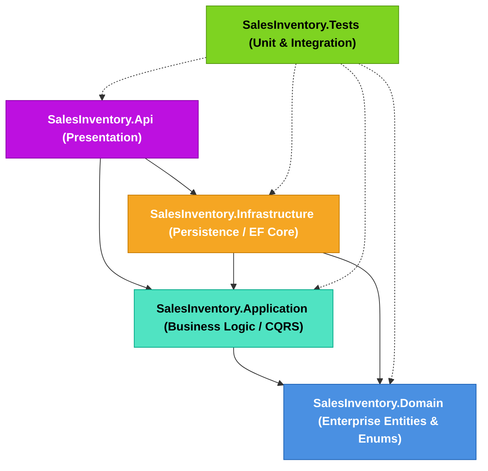
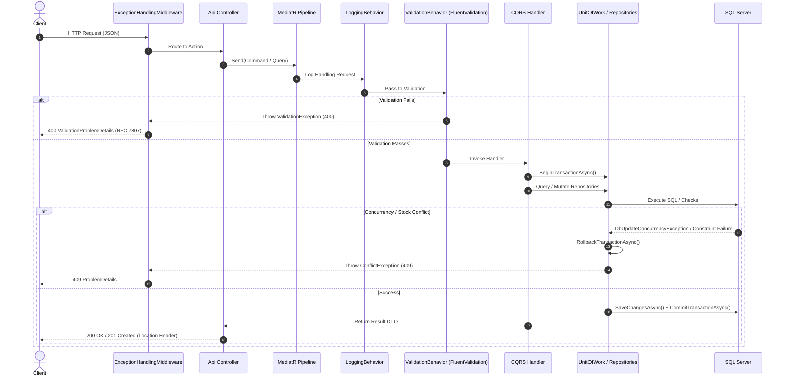

# Sales & Inventory Management API


-success?logo=xunit)

A production-grade, enterprise-ready Sales and Inventory Management REST API built with **.NET 8**, **ASP.NET Core**, **Entity Framework Core 8**, and **Microsoft SQL Server**.

The project implements **Clean Architecture**, **CQRS with MediatR**, **FluentValidation pipeline behaviors**, **AutoMapper**, **SQL Server `rowversion` optimistic concurrency**, **atomic multi-entity transactions with rollback guarantees**, **performance-engineered EF Core queries (N+1 eliminated)**, and centralized **RFC 7807 ProblemDetails** error handling.

---

## Table of Contents
1. [Architecture & Design Principles](#1-architecture--design-principles)
2. [Project Structure](#2-project-structure)
3. [Request Pipeline & Execution Flow](#3-request-pipeline--execution-flow)
4. [Key Engineering Highlights & Decisions](#4-key-engineering-highlights--decisions)
   - [Optimistic Concurrency Control (`rowversion`)](#optimistic-concurrency-control-rowversion)
   - [Atomic Transactions & Unit of Work](#atomic-transactions--unit-of-work)
   - [N+1 Query Elimination & Performance Engineering](#n1-query-elimination--performance-engineering)
   - [Authoritative Pricing & Line-Item Snapshots](#authoritative-pricing--line-item-snapshots)
   - [Referential Integrity & Safe Deletion](#referential-integrity--safe-deletion)
5. [Database Setup & Migrations](#5-database-setup--migrations)
6. [Data Seeding & Test Isolation Strategy](#6-data-seeding--test-isolation-strategy)
7. [API Specification & Endpoints](#7-api-specification--endpoints)
8. [Unified Error Handling (RFC 7807)](#8-unified-error-handling-rfc-7807)
9. [How to Run and Test (Reviewer Quickstart)](#9-how-to-run-and-test-reviewer-quickstart)
10. [Automated Test Suite (192 Tests)](#10-automated-test-suite-192-tests)

---

## 1. Architecture & Design Principles

The solution adheres strictly to **Clean Architecture** (Onion Architecture) guidelines, enforcing unidirectional dependencies pointing inward toward the domain:



### Layer Responsibilities
- **Domain Layer (`SalesInventory.Domain`)**: Pure C# domain entities (`Product`, `SalesOrder`, `OrderItem`) and enums (`OrderStatus`). Zero external dependencies or framework references. Holds concurrency token properties (`byte[] RowVersion`).
- **Application Layer (`SalesInventory.Application`)**: Core application logic. Contains CQRS Commands/Queries, MediatR Handlers, DTOs, FluentValidation rules, pipeline behaviors, AutoMapper profiles, custom exceptions, and repository interfaces.
- **Infrastructure Layer (`SalesInventory.Infrastructure`)**: Implements persistence abstractions using EF Core 8 and SQL Server. Contains `AppDbContext`, Fluent API configurations (`IEntityTypeConfiguration<T>`), repository implementations, `UnitOfWork` transaction handling, migrations, and generic query extensions (`ToPagedAsync`).
- **Presentation Layer (`SalesInventory.Api`)**: ASP.NET Core Web API. Thin controllers delegating all operations to MediatR, Swagger / OpenAPI documentation, and centralized `ExceptionHandlingMiddleware`.
- **Test Layer (`SalesInventory.Tests`)**: Comprehensive xUnit automated test suite with unit tests, architecture governance tests, and integration tests running against SQL Server.

---

## 2. Project Structure

```text
SalesInventory/
├── SalesInventory.Domain/
│   ├── Entities/
│   │   ├── OrderItem.cs
│   │   ├── Product.cs
│   │   └── SalesOrder.cs
│   └── Enums/
│       └── OrderStatus.cs
│
├── SalesInventory.Application/
│   ├── Behaviors/
│   │   ├── LoggingBehavior.cs
│   │   └── ValidationBehavior.cs
│   ├── Exceptions/
│   │   ├── ConflictException.cs
│   │   ├── InsufficientStockException.cs
│   │   ├── NotFoundException.cs
│   │   └── ValidationException.cs
│   ├── Features/
│   │   ├── Orders/
│   │   │   ├── Commands/
│   │   │   │   ├── CancelOrderCommand.cs
│   │   │   │   ├── CancelOrderCommandHandler.cs
│   │   │   │   ├── CreateOrderCommand.cs
│   │   │   │   └── CreateOrderCommandHandler.cs
│   │   │   ├── DTOs/
│   │   │   │   ├── CreateOrderItemRequest.cs
│   │   │   │   ├── OrderDto.cs
│   │   │   │   ├── OrderItemDto.cs
│   │   │   │   └── OrderListItemDto.cs
│   │   │   ├── Queries/
│   │   │   │   ├── GetOrderByIdQuery.cs
│   │   │   │   ├── GetOrderByIdQueryHandler.cs
│   │   │   │   ├── GetOrdersQuery.cs
│   │   │   │   └── GetOrdersQueryHandler.cs
│   │   │   └── Validators/
│   │   │       ├── CancelOrderCommandValidator.cs
│   │   │       ├── CreateOrderCommandValidator.cs
│   │   │       ├── CreateOrderItemRequestValidator.cs
│   │   │       ├── GetOrderByIdQueryValidator.cs
│   │   │       └── GetOrdersQueryValidator.cs
│   │   └── Products/
│   │       ├── Commands/
│   │       │   ├── CreateProductCommand.cs
│   │       │   ├── CreateProductCommandHandler.cs
│   │       │   ├── DeleteProductCommand.cs
│   │       │   ├── DeleteProductCommandHandler.cs
│   │       │   ├── UpdateProductCommand.cs
│   │       │   └── UpdateProductCommandHandler.cs
│   │       ├── DTOs/
│   │       │   ├── PagedResult.cs
│   │       │   ├── ProductDto.cs
│   │       │   └── ProductListItemDto.cs
│   │       ├── Queries/
│   │       │   ├── GetProductByIdQuery.cs
│   │       │   ├── GetProductByIdQueryHandler.cs
│   │       │   ├── GetProductsQuery.cs
│   │       │   └── GetProductsQueryHandler.cs
│   │       └── Validators/
│   │           ├── CreateProductCommandValidator.cs
│   │           ├── DeleteProductCommandValidator.cs
│   │           ├── GetProductByIdQueryValidator.cs
│   │           ├── GetProductsQueryValidator.cs
│   │           └── UpdateProductCommandValidator.cs
│   ├── Interfaces/
│   │   ├── IOrderRepository.cs
│   │   ├── IProductRepository.cs
│   │   └── IUnitOfWork.cs
│   ├── Mapping/
│   │   ├── OrderProfile.cs
│   │   └── ProductProfile.cs
│   └── DependencyInjection.cs
│
├── SalesInventory.Infrastructure/
│   ├── Extensions/
│   │   └── QueryableExtensions.cs           <-- Generic IQueryable ToPagedAsync<T>
│   ├── Persistence/
│   │   ├── AppDbContext.cs
│   │   ├── Configurations/
│   │   │   ├── OrderItemConfiguration.cs
│   │   │   ├── ProductConfiguration.cs
│   │   │   └── SalesOrderConfiguration.cs
│   │   └── Migrations/
│   │       ├── 20261028085637_InitialCreate.cs
│   │       ├── 20261028110551_AddRowVersionConcurrency.cs
│   │       └── 20261028161901_AddUniqueProductIndex.cs
│   ├── Repositories/
│   │   ├── OrderRepository.cs
│   │   ├── ProductRepository.cs
│   │   └── UnitOfWork.cs
│   └── DependencyInjection.cs
│
├── SalesInventory.Api/
│   ├── Controllers/
│   │   ├── OrdersController.cs
│   │   └── ProductsController.cs
│   ├── Middleware/
│   │   └── ExceptionHandlingMiddleware.cs    <-- Centralized ProblemDetails Handler
│   ├── appsettings.json
│   ├── appsettings.Development.json
│   └── Program.cs
│
└── SalesInventory.Tests/
    ├── Architecture/
    │   └── ArchitectureAndConfigurationTests.cs  <-- Layer boundaries & DI verification
    ├── Integration/
    │   ├── ConcurrencyIntegrationTests.cs        <-- Parallel race conditions & rowversion
    │   ├── OrdersApiExtendedTests.cs
    │   ├── OrdersApiTests.cs
    │   ├── ProductsApiExtendedTests.cs
    │   ├── ProductsApiTests.cs
    │   └── TransactionRollbackTests.cs           <-- Failure rollback verification
    └── Unit/
        ├── Application/
        │   ├── Orders/
        │   │   ├── CancelOrderCommandHandlerTests.cs
        │   │   ├── CancelOrderCommandValidatorTests.cs
        │   │   ├── CreateOrderCommandHandlerTests.cs
        │   │   ├── CreateOrderCommandValidatorTests.cs
        │   │   ├── GetOrderByIdQueryHandlerTests.cs
        │   │   ├── GetOrderByIdQueryValidatorTests.cs
        │   │   └── GetOrdersQueryHandlerTests.cs
        │   └── Products/
        │       ├── CreateProductCommandHandlerTests.cs
        │       ├── DeleteProductCommandHandlerTests.cs
        │       ├── DeleteProductCommandValidatorTests.cs
        │       ├── GetProductByIdQueryHandlerTests.cs
        │       ├── GetProductByIdQueryValidatorTests.cs
        │       ├── GetProductsQueryHandlerTests.cs
        │       └── UpdateProductCommandHandlerTests.cs
        └── Validators/
            └── ValidatorTests.cs
```

---

## 3. Request Pipeline & Execution Flow

All requests flow through a MediatR pipeline governed by cross-cutting behaviors:



---

## 4. Key Engineering Highlights & Decisions

### Optimistic Concurrency Control (`rowversion`)
- **Mechanism**: The `Product` and `SalesOrder` entities define a `byte[] RowVersion` property configured via `.IsRowVersion()` in EF Core:
  ```csharp
  builder.Property(p => p.RowVersion).IsRowVersion();
  ```
- **Execution**: When updating a product's stock or cancelling an order, EF Core automatically includes the original binary timestamp in the `WHERE` clause:
  ```sql
  UPDATE [Products]
  SET [StockQuantity] = @newStock, [UpdatedAt] = @now
  WHERE [Id] = @id AND [RowVersion] = @originalRowVersion;
  ```
- **Conflict Handling**: If another transaction modified the entity concurrently, SQL Server returns 0 affected rows. EF Core raises a `DbUpdateConcurrencyException`, which is caught by `UnitOfWork` and converted into a `ConflictException` (HTTP 409 Conflict), guaranteeing no lost updates under high concurrency.

### Atomic Transactions & Unit of Work
- Multi-step business operations (e.g., deducting stock across multiple products, recording line items, and persisting the sales order) are executed inside an explicit database transaction (`BeginTransactionAsync`).
- If any operation fails (e.g., negative stock, missing product, concurrency conflict, or system failure), the transaction triggers `RollbackTransactionAsync()`, ensuring zero orphaned records or corrupted stock counts.

### N+1 Query Elimination & Performance Engineering
1. **Generic Pagination Extension (`ToPagedAsync`)**:
   - Located in [`SalesInventory.Infrastructure.Extensions.QueryableExtensions`](file:///d:/SalesInventory/SalesInventory.Infrastructure/Extensions/QueryableExtensions.cs).
   - Combines server-side `CountAsync` and paged fetch (`Skip/Take`) into a single reusable call on any `IQueryable<T>`.
2. **Eliminated Order Item N+1 Loading**:
   - `OrderRepository.GetPagedAsync` projects directly to `OrderListItemDto` using LINQ `.Select()`.
   - Calculates `ItemCount = o.Items.Count` directly inside SQL Server without loading full `OrderItem` entity graphs into memory.
3. **`AsNoTracking()` on All Queries**:
   - Every read-only query in `ProductRepository` and `OrderRepository` uses `.AsNoTracking()` to eliminate EF Core change tracker overhead and memory footprint.
4. **`AsSplitQuery()` on Detailed Graph Queries**:
   - `OrderRepository.GetByIdWithItemsAsync` employs `.AsSplitQuery()` to prevent Cartesian explosion when joining orders with their line items.
5. **Batch Product Loading (`WHERE Id IN (...)`)**:
   - Products in `CreateOrderCommandHandler` and `CancelOrderCommandHandler` are fetched in a single round-trip using `GetByIdsAsync(productIds)` instead of sequential single-record queries in a loop.
6. **Deterministic Lock Ordering**:
   - Products are processed in sorted order (`OrderBy(p => p.ProductId)`) during both order placement and stock restoration, preventing SQL Server deadlocks.

### Authoritative Pricing & Line-Item Snapshots
- The API **never trusts client-supplied prices or line totals**.
- Current product prices are fetched directly from the database during order processing.
- The server captures a historical `UnitPrice` snapshot on each `OrderItem`, ensuring future price changes on `Product` do not alter historical orders.

### Referential Integrity & Safe Deletion
- Foreign key constraints specify `DeleteBehavior.Restrict` from `Product` to `OrderItems`.
- `DeleteProductCommandHandler` performs an explicit check (`HasOrderReferencesAsync`) before attempting deletion and returns HTTP 409 Conflict if historical orders reference the product.

---

## 5. Database Setup & Migrations

### Prerequisites
- **.NET 8 SDK** (v8.0.x or higher)
- **Microsoft SQL Server** (LocalDB, SQL Express, Developer Edition, or Docker SQL Server)

### Connection String Configuration
Configured in `SalesInventory.Api/appsettings.json`:
```json
{
  "ConnectionStrings": {
    "DefaultConnection": "Server=.;Database=SalesInventoryDb;Trusted_Connection=True;TrustServerCertificate=True"
  }
}
```

### Apply Migrations
From the solution root directory, execute:
```bash
dotnet ef database update --project SalesInventory.Infrastructure --startup-project SalesInventory.Api
```

The database includes three applied migrations:
1. `20261028085637_InitialCreate`: Initial table schemas, primary keys, and foreign keys.
2. `20261028110551_AddRowVersionConcurrency`: Adds SQL Server `rowversion` columns to `Products` and `Orders`.
3. `20261028161901_AddUniqueProductIndex`: Adds unique index `IX_Products_Name` on `Products.Name`.

---

## 6. Data Seeding & Test Isolation Strategy

### Why is there no static Seeder in the code?
1. **Integration Test Independence**: The test suite follows modern cloud-native testing patterns where tests are completely self-contained. Each test creates its own required products and orders using dynamic `Guid` fixtures.
2. **Zero Seed Pollution**: Tests never rely on pre-existing IDs or static records, ensuring 100% deterministic test execution in any environment or CI/CD runner.

> [!NOTE]
> **Database State After Running Tests:**
> When `dotnet test` executes, integration tests run against the configured SQL Server database (`SalesInventoryDb`). As a result, test products and test orders (some completed, some cancelled during tests) will be present in the database with timestamps matching test run time.

### Quick Database Reset (Optional for Reviewers)
If you want to start with a fresh, empty database before manual Swagger testing, run this SQL script in SSMS, Azure Data Studio, or via sqlcmd:

```sql
USE [SalesInventoryDb];
DELETE FROM [OrderItems];
DELETE FROM [Orders];
DELETE FROM [Products];
```

---

## 7. API Specification & Endpoints

### Products API (`/api/products`)

| Method | Endpoint | Description | Status Codes |
|---|---|---|---|
| `GET` | `/api/products` | Get paged & search-filtered products | `200 OK`, `400 BadRequest` |
| `GET` | `/api/products/{id}` | Get product details by ID | `200 OK`, `404 NotFound` |
| `POST` | `/api/products` | Create a new product | `201 Created`, `400 BadRequest`, `409 Conflict` |
| `PUT` | `/api/products/{id}` | Update product details | `200 OK`, `400 BadRequest`, `404 NotFound`, `409 Conflict` |
| `DELETE` | `/api/products/{id}` | Delete product (restricted if ordered) | `204 NoContent`, `404 NotFound`, `409 Conflict` |

#### Create Product Example
**`POST /api/products`**
```json
{
  "name": "Mechanical Keyboard Pro",
  "price": 129.99,
  "stockQuantity": 50
}
```
**`Response (201 Created)`**
- `Location`: `https://localhost:7085/api/products/4f3a8b21-789a-4c12-98ab-34cd56ef7890`
```json
{
  "id": "4f3a8b21-789a-4c12-98ab-34cd56ef7890",
  "name": "Mechanical Keyboard Pro",
  "price": 129.99,
  "stockQuantity": 50,
  "createdAt": "2026-10-29T10:00:00Z",
  "updatedAt": "2026-10-29T10:00:00Z"
}
```

---

### Orders API (`/api/orders`)

| Method | Endpoint | Description | Status Codes |
|---|---|---|---|
| `GET` | `/api/orders` | Get paged orders summary list | `200 OK`, `400 BadRequest` |
| `GET` | `/api/orders/{id}` | Get full order details with line items | `200 OK`, `404 NotFound` |
| `POST` | `/api/orders` | Create an order & atomically deduct inventory | `201 Created`, `400 BadRequest`, `404 NotFound`, `409 Conflict` |
| `POST` | `/api/orders/{id}/cancel` | Cancel order & restore inventory | `204 NoContent`, `404 NotFound`, `409 Conflict` |

#### Create Order Example
**`POST /api/orders`**
```json
{
  "items": [
    {
      "productId": "4f3a8b21-789a-4c12-98ab-34cd56ef7890",
      "quantity": 2
    }
  ]
}
```
**`Response (201 Created)`**
```json
{
  "id": "a1b2c3d4-e5f6-7890-abcd-ef1234567890",
  "orderDate": "2026-10-29T10:05:00Z",
  "totalAmount": 259.98,
  "status": 2,
  "statusName": "Completed",
  "items": [
    {
      "id": "b2c3d4e5-f6a7-8901-bcde-f12345678901",
      "productId": "4f3a8b21-789a-4c12-98ab-34cd56ef7890",
      "productName": "Mechanical Keyboard Pro",
      "quantity": 2,
      "unitPrice": 129.99,
      "lineTotal": 259.98
    }
  ]
}
```

---

## 8. Unified Error Handling (RFC 7807)

The API enforces standardized error handling using the **RFC 7807 ProblemDetails** specification with `Content-Type: application/problem+json`.

| Exception Type | HTTP Status | RFC 7807 Title | Description |
|---|---|---|---|
| `ValidationException` | `400 BadRequest` | `"Validation Failed"` | FluentValidation errors mapped to field names |
| `NotFoundException` | `404 NotFound` | `"Resource Not Found"` | Requested product or order does not exist |
| `InsufficientStockException` | `409 Conflict` | `"Insufficient Stock"` | Requested quantity exceeds available inventory |
| `ConflictException` | `409 Conflict` | `"Conflict"` | Concurrency token mismatch or invalid state change |
| `DbUpdateException` | `409 Conflict` | `"Conflict"` | Unique constraint or foreign key violation |
| `Exception` (Unhandled) | `500 InternalServerError` | `"Internal Server Error"` | Unexpected error; internal details masked |

### Sample Validation Error Response (`400 Bad Request`)
```json
{
  "type": "https://tools.ietf.org/html/rfc9110#section-15.5.1",
  "title": "Validation Failed",
  "status": 400,
  "errors": {
    "Name": [
      "Product name is required.",
      "Product name must not exceed 200 characters."
    ],
    "Price": [
      "Product price must be greater than or equal to 0."
    ]
  }
}
```

### Sample Concurrency / Conflict Error Response (`409 Conflict`)
```json
{
  "type": "https://tools.ietf.org/html/rfc9110#section-15.5.10",
  "title": "Conflict",
  "status": 409,
  "detail": "The entity was updated or deleted by another transaction."
}
```

---

## 9. How to Run and Test (Reviewer Quickstart)

### 1. Clone & Build
```bash
git clone <repository-url>
cd SalesInventory
dotnet restore
dotnet build
```

### 2. Update Database
```bash
dotnet ef database update --project SalesInventory.Infrastructure --startup-project SalesInventory.Api
```

### 3. Run Web API
```bash
dotnet run --project SalesInventory.Api
```
- Interactive Swagger UI: `https://localhost:7085/swagger`
- HTTP Swagger UI: `http://localhost:5246/swagger`

### 4. Run Automated Tests
```bash
dotnet test
```

---

## 10. Automated Test Suite (192 Tests)

The solution includes an extensive, enterprise-grade test suite with **192 automated tests (100% passing)**:

```bash
Passed!  - Failed: 0, Passed: 192, Skipped: 0, Total: 192, Duration: 6 s
```

### Test Coverage Breakdown
- **Architecture & DI Tests (`ArchitectureAndConfigurationTests.cs`)**: Verifies Clean Architecture boundaries (no illegal layer references), AutoMapper profile validity, DbContext connectivity, and DI registrations.
- **Concurrency Integration Tests (`ConcurrencyIntegrationTests.cs`)**: Simulates 10+ concurrent threads executing simultaneous orders and updates against the same product to verify SQL Server `rowversion` collision handling.
- **Transactional Rollback Tests (`TransactionRollbackTests.cs`)**: Proves that multi-item order failures immediately roll back stock deductions atomically.
- **API Integration Tests (`ProductsApiTests.cs`, `OrdersApiTests.cs`, `ExtendedTests.cs`)**: End-to-end integration tests using `WebApplicationFactory<Program>` validating HTTP status codes, headers, and payload structures.
- **Unit & Validator Tests (`Unit/Application/*`)**: Isolated xUnit tests verifying command handlers, business calculations, and every FluentValidation rule in isolation.

---

### Author & Engineering Standards
Built in compliance with senior .NET engineering standards, Clean Architecture patterns, and Microsoft REST API guidelines.
